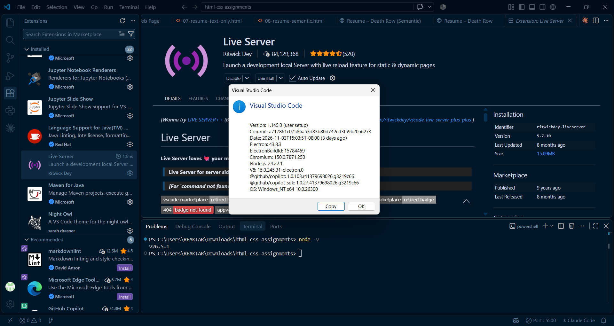

# Assignment 2 – Setup Proof (VS Code, Node.js, Live Server)

> A screenshot has to come from _your_ machine, so I can't generate it for you. Follow the checklist, take the screenshot, save it as `screenshots/setup-proof.png` and the embed line below will display it.

## Steps

1. **VS Code** – open it, then _Help → About_ (note the version).
2. **Node.js** – open the VS Code terminal (`` Ctrl+` ``) and run:
   ```bash
   node -v
   npm -v
   ```
3. **Live Server** – Extensions panel (`Ctrl+Shift+X`) → search _Live Server_ by Ritwick Dey → Install. Open any `.html` file → right-click → **Open with Live Server** (or click _Go Live_ in the status bar).
4. Arrange the window so that **VS Code, the terminal output (`node -v`), the Live Server extension and the browser tab running on `127.0.0.1:5500`** are all visible, then take the screenshot.

## My proof



| Tool        | Version   | Installed correctly? |
| ----------- | --------- | -------------------- |
| VS Code     | _fill in_ | ✅                   |
| Node.js     | _fill in_ | ✅                   |
| Live Server | _fill in_ | ✅                   |
